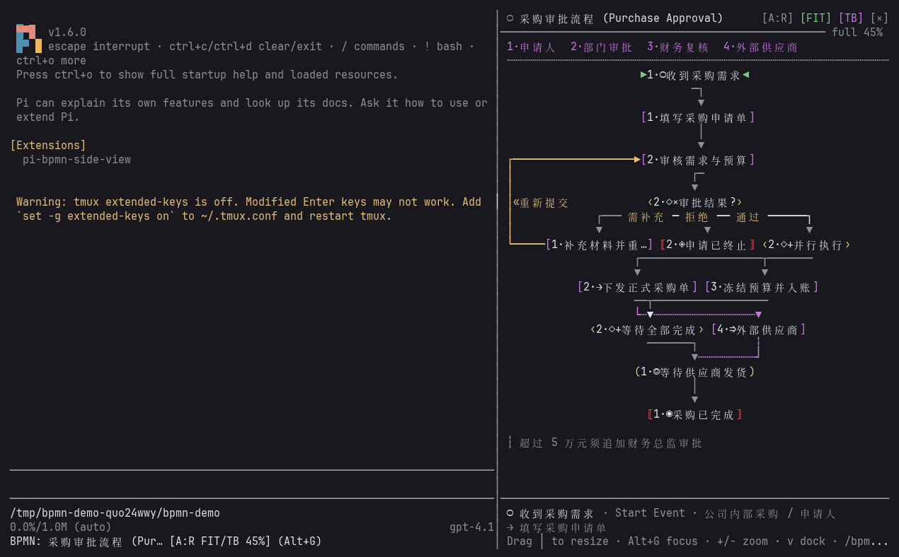
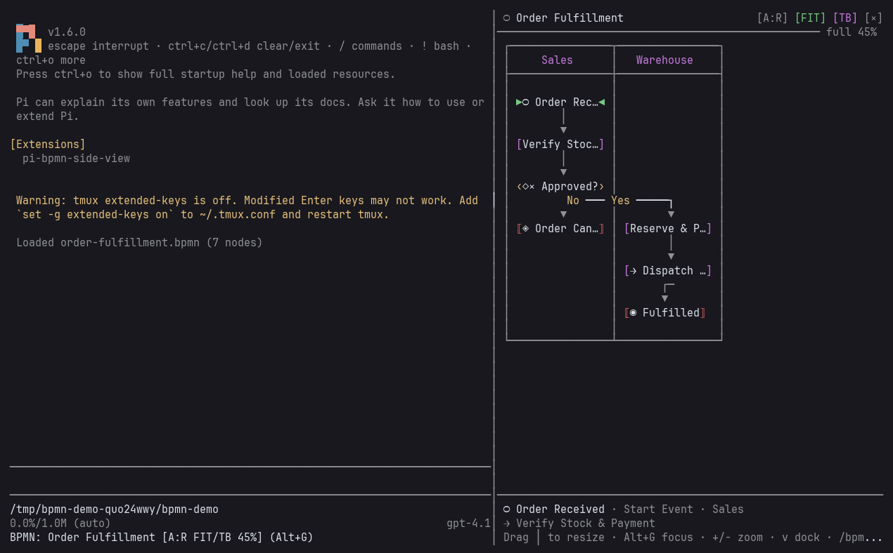
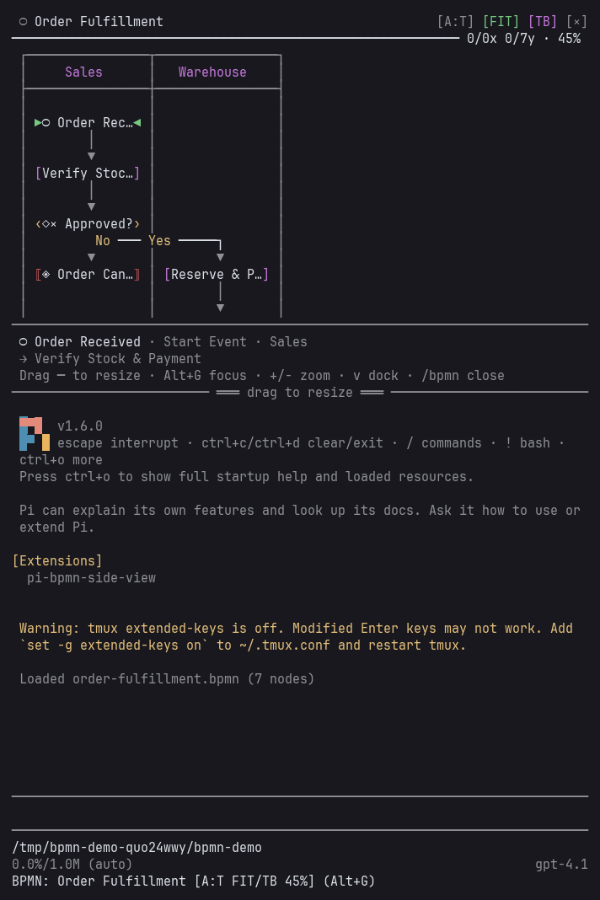

# pi-bpmn-side-view

**Interactive BPMN 2.0 split-view inside the [Pi coding agent](https://pi.dev/) terminal.**

Inspect and iterate on BPMN 2.0 workflows right next to your Pi chat — without switching to a browser, losing editor focus, or fighting tmux image protocols.

Zero runtime dependencies. Works over SSH, inside tmux, on landscape and portrait monitors, with crisp CJK and English labels.



## Why

- **True split view, zero overlap**: In Pi fullscreen mode (`tuiMode: "fullscreen"`), chat and input stay on the left while BPMN renders on the right. Keep typing while reading the flow.
- **Auto-fit full diagram (`FIT`, default)**: Terminal emulators inside tmux cannot pinch-to-zoom. `FIT` adapts the entire multi-lane diagram to your pane dimensions so you see start-to-end on one screen; press `+` anytime to zoom into compact (`CMP`) or full boxed (`DET`) swimlanes.
- **Landscape & portrait aware**: Right-side split on wide screens, automatic **top-bottom split** on vertical monitors (`auto`, or press `v` / `/bpmn dock`).
- **Trackpad & mouse native**: Drag the divider border to resize (20%–75%), grab-and-drag inside the canvas to pan in 2D, scroll vertically or horizontally, and click any node to inspect its lane, documentation, and outgoing conditions.
- **Agent-native**: Exposes the `show_bpmn` tool so Pi can open or update the diagram directly, auto-detects fenced ```bpmn``` XML replies, and live-reloads `.bpmn` files on disk changes.

<details>
<summary>More screenshots: Swimlanes & Portrait Monitor Split</summary>

### Boxed Swimlanes


### Portrait Terminal (Auto Top Split + Draggable Horizontal Divider)


</details>

## Install

Requires Node.js >= 22.19 and Pi >= 1.6.0.

**From npm:**

```bash
pi install npm:pi-bpmn-side-view
```

**From GitHub (pinned release tag):**

```bash
pi install git:github.com/henrywen98/pi-bpmn-side-view@v0.1.0
```

**Try once without installing:**

```bash
pi -e npm:pi-bpmn-side-view
```

Run `/reload` in Pi (or restart Pi), then run `/bpmn demo`.

## Quick Start

```text
/bpmn demo                      # Open built-in multi-lane Purchase Approval BPMN 2.0 demo
/bpmn ./workflow.bpmn           # Open and live-watch a local .bpmn file
/bpmn list                      # Pick from .bpmn files in the workspace
/bpmn fit                       # Auto-fit full diagram to pane
/bpmn zoom fit|compact|detail   # Switch density level
/bpmn layout tb|lr              # Vertical (TB) or horizontal (LR) swimlanes
/bpmn dock auto|right|top|bottom# Panel placement (auto adapts to portrait monitors)
/bpmn size 50                   # Set pane size percentage (20-75)
/bpmn modal                     # Full-screen overlay (useful on tiny terminals)
/bpmn close                     # Close the BPMN view
```

You can also ask Pi directly: *"Draw our refund approval flow as BPMN 2.0 and show it on the right."* — Pi calls `show_bpmn` automatically.

## Controls

| Action | Mouse / Trackpad | Keyboard (after `Alt+G` or click) |
| --- | --- | --- |
| Resize panel | Drag `│` (right) or `─` (top/bottom) border | `[` / `]` |
| Pan diagram | Grab-and-drag canvas, 2-finger scroll, Shift+scroll | `h/j/k/l` or arrow keys, `u/d` / `PgUp/PgDn` |
| Zoom / Auto-fit | Click `[FIT]` in header | `+` / `-` / `f` |
| Switch `TB` ↔ `LR` | Click `[TB]` in header | `o` |
| Switch dock position | Click `[A:R]` in header | `v` |
| Select & inspect node | Click any node | `Tab` / `Shift+Tab` (or `n` / `p`) |
| Model summary drawer | — | `i` |
| Return focus to chat | Click chat pane | `Esc` or `Alt+G` |
| Close panel | Click `[×]` in header | `q` or `/bpmn close` |

## Supported BPMN 2.0 Elements

- **Containers**: Collaborations, Pools (including black-box external participants), Lanes, nested `childLaneSet`
- **Events**: Start, End, Intermediate Catch/Throw, Boundary (`attachedToRef`) with Timer, Message, Error, Signal, and Terminate markers
- **Activities**: Task, User Task, Service Task, Script Task, Manual Task, Business Rule Task, Send/Receive Task, Call Activity, Sub-Process
- **Gateways**: Exclusive (`◇×`), Parallel (`◇+`), Inclusive (`◇○`), Event-based (`◇◎`), Complex (`◇*`)
- **Connections & Notes**: Sequence flows (with conditions & default marker), dashed Message flows across pools, cycle-safe rework loops, Text Annotations

## Development & Testing

```bash
npm run typecheck
npm test
/usr/bin/python3 test/tui-e2e.py --out evidence
```

## License

MIT © Henry WEN
